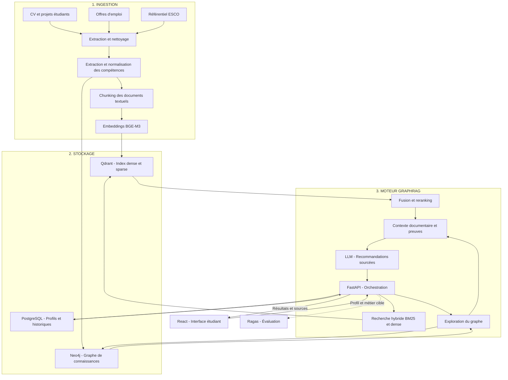

# Architecture technique — PathForge AI

## 1. Présentation générale

PathForge AI est une plateforme intelligente d'analyse des
compétences et d'orientation professionnelle basée sur une
architecture GraphRAG hybride.

Elle analyse les compétences documentées par les CV, les projets
et les stages des étudiants, puis les compare aux exigences
professionnelles associées aux métiers ciblés.

La solution combine :

- Recherche hybride : BM25 + embeddings.
- Base vectorielle : Qdrant.
- Reranking : Cross-Encoder.
- Graphe de connaissances : Neo4j.
- Génération augmentée : LLM.
- Backend : FastAPI et Pydantic v2.
- Frontend : React.
- Base relationnelle : PostgreSQL.

L'architecture comporte deux pipelines complémentaires :

1. Ingestion, préparation et indexation des données.
2. Recherche, analyse des écarts et génération des recommandations.

Les composants non encore développés constituent
l'architecture cible du prototype.

---

## 2. Schéma d'architecture générale

**Lecture du schéma :**

- Le pipeline d'ingestion prépare les sources et alimente
  les systèmes de stockage et d'indexation.
- Qdrant retrouve les informations documentaires pertinentes.
- Neo4j permet d'explorer les relations entre les entités.
- FastAPI orchestre les recherches et la construction du contexte.
- Le LLM génère des recommandations à partir des preuves disponibles.
- React présente les résultats à l'étudiant.
- Ragas permet d'évaluer la qualité des réponses.

Les relations ESCO sont conservées sous une forme structurée
pour l'import dans Neo4j. Elles ne nécessitent pas de chunking.

---

## 3. Sources de données

### 3.1 Référentiel ESCO

**Source officielle :**
https://esco.ec.europa.eu/en/use-esco/download

**Version :** ESCO v1.2.1.

Fichiers présents dans le dépôt :

| Fichier | Contenu |
|---|---|
| occupations_en.csv | 3 043 métiers |
| skills_en.csv | 13 960 compétences |
| occupationSkillRelations_data_ai_en.csv | 674 relations filtrées |

Les relations filtrées portent sur huit métiers orientés
Data, intelligence artificielle et développement logiciel.

Ces données permettront de normaliser les compétences
et de construire les relations métiers-compétences.

Le script `scripts/validate_esco.py` a vérifié les
674 relations filtrées.

**Résultat de validation :**

- Relations avec métier inconnu : 0.
- Relations avec compétence inconnue : 0.
- Intégrité référentielle du sous-ensemble : validée.

Cette vérification ne constitue pas encore une validation
complète de la pertinence sémantique des correspondances.

### 3.2 Offres d'emploi

**Source envisagée :**
LinkedIn Job Postings (2023–2024), Kaggle.

https://www.kaggle.com/datasets/arshkon/linkedin-job-postings

Les offres permettront d'analyser les compétences
et qualifications demandées par les employeurs.

Le corpus étant historique, il ne représente pas
nécessairement les exigences actuelles du marché.

### 3.3 Profils étudiants

Un corpus de profils fictifs ou anonymisés
sera constitué pour les expérimentations.

Informations prévues :

- Formation académique.
- Projets universitaires.
- Expériences de stage.
- Compétences déclarées.
- Technologies documentées.
- Métier cible.

---

## 4. Pipeline d'ingestion et de préparation

### Étape 1 — Extraction

Python et Pandas seront utilisés pour lire
et préparer les fichiers CSV et JSON.

Les CV PDF seront traités avec un outil
d'extraction de texte adapté.

### Étape 2 — Nettoyage et normalisation

Les traitements comprendront :

- Suppression des doublons.
- Gestion des valeurs manquantes.
- Normalisation des intitulés de métiers.
- Extraction des compétences.
- Rapprochement des compétences avec ESCO.
- Conservation des identifiants et des sources.

Les correspondances incertaines avec ESCO seront
signalées plutôt que considérées comme validées.

### Étape 3 — Chunking

**Stratégie envisagée :** Recursive Character Chunking.

**Taille cible :** 512 tokens.

**Overlap cible :** 64 tokens.

Les métadonnées comprendront notamment :

- `doc_id`
- `chunk_id`
- `source`
- `document_type`
- `job_id` ou `profile_id`, si applicable
- `esco_uri`, lorsqu'un lien ESCO est validé

Les relations métiers-compétences d'ESCO
seront traitées comme des données structurées.

### Étape 4 — Génération des embeddings

**Modèle envisagé :** `BAAI/bge-m3`.

**Dimension des vecteurs denses :** 1 024.

Les représentations vectorielles seront
indexées dans Qdrant avec leurs métadonnées.

L'indexation sparse nécessaire au BM25
sera configurée séparément dans le pipeline.

### Étape 5 — Construction du graphe

Les métiers, compétences et relations ESCO seront
importés dans Neo4j.

Les preuves extraites des projets étudiants
et les exigences issues des offres seront ensuite
associées aux entités correspondantes.

---

## 5. Recherche hybride et reranking

### 5.1 Recherche lexicale — BM25

La recherche lexicale permet de retrouver
les passages contenant des termes importants,
notamment les noms de technologies et de métiers.

### 5.2 Recherche sémantique

Les embeddings permettent de retrouver
des passages sémantiquement proches,
même lorsque les formulations diffèrent.

### 5.3 Fusion des résultats

Les résultats lexicaux et sémantiques
seront combinés pour obtenir un classement initial.

Une stratégie de fusion telle que
Reciprocal Rank Fusion (RRF) pourra être utilisée.

### 5.4 Reranking

**Modèle envisagé :** `BAAI/bge-reranker-v2-m3`.

Le Cross-Encoder évaluera la pertinence
des passages candidats par rapport à la requête.

**Configuration cible :**

- Récupération initiale : Top-20.
- Reranking : Cross-Encoder.
- Sélection finale : Top-5.

Le reranking sera exécuté dans le moteur applicatif,
après la récupération initiale des candidats.

---

## 6. Graphe de connaissances Neo4j

Neo4j permettra de représenter les relations
entre les étudiants, leurs expériences et les métiers.

### 6.1 Entités principales

- Etudiant
- Projet
- Competence
- Metier
- OffreEmploi

### 6.2 Relations principales

- Etudiant -> REALISE -> Projet
- Projet -> DOCUMENTE -> Competence
- Metier -> REQUIERT -> Competence
- OffreEmploi -> MENTIONNE -> Competence
- Etudiant -> CIBLE -> Metier

Chaque relation devra conserver sa provenance
lorsque des informations justificatives sont disponibles.

### 6.3 Exploitation du graphe

Le graphe permettra notamment de :

1. Retrouver les compétences documentées
   par les projets d'un étudiant.
2. Identifier les compétences associées
   au métier ciblé.
3. Relier les exigences d'une offre aux
   compétences normalisées.
4. Reconstruire des chemins de preuves.
5. Justifier les correspondances entre
   un profil étudiant et un métier.

**Exemple :**

Projet NLP -> DOCUMENTE -> Python

GenAI Engineer -> REQUIERT -> Python

Ce chemin montre que Python est documenté
dans un projet et associé à un métier.

Il ne prouve pas à lui seul que l'étudiant
maîtrise toutes les compétences du métier.

---

## 7. Analyse des écarts et génération des recommandations

### 7.1 Analyse des écarts

Pour un métier cible, PathForge comparera :

- Les compétences documentées dans le profil.
- Les compétences exigées par les offres et ESCO.
- Les compétences déclarées sans preuve suffisante.
- Les compétences exigées mais non documentées.

L'absence de preuve ne sera pas assimilée
automatiquement à une absence de maîtrise.

### 7.2 Construction du contexte GraphRAG

Le moteur combinera :

1. Les passages pertinents retrouvés dans Qdrant.
2. Les relations pertinentes du graphe Neo4j.
3. Le métier cible sélectionné.
4. Les compétences et expériences documentées.
5. Les références aux sources utilisées.

### 7.3 Génération augmentée

Un LLM exploitera ce contexte pour produire :

- Une synthèse des compétences documentées.
- Une présentation des exigences du métier.
- Une analyse argumentée des écarts.
- Des recommandations personnalisées.
- Les sources justifiant les conclusions.

Le modèle devra signaler explicitement
les cas où les données sont insuffisantes.

---

## 8. Backend, frontend et stockage applicatif

### 8.1 Backend — FastAPI

FastAPI assurera :

- La validation des entrées avec Pydantic v2.
- L'import des profils et documents.
- L'orchestration des requêtes Qdrant.
- L'exploration du graphe Neo4j.
- L'analyse des écarts de compétences.
- La construction du contexte GraphRAG.
- L'appel au modèle de génération.
- La restitution des réponses et des sources.

Un mécanisme SSE sera envisagé pour
l'affichage progressif des réponses.

### 8.2 Frontend — React

L'interface permettra à l'étudiant de :

1. Importer son CV.
2. Renseigner ses projets et expériences.
3. Sélectionner un métier cible.
4. Consulter les compétences documentées.
5. Visualiser les écarts identifiés.
6. Consulter les recommandations et leurs sources.

L'interface affichera également les états
de chargement et les erreurs éventuelles.

### 8.3 PostgreSQL

PostgreSQL assurera le stockage des données
applicatives autorisées, notamment :

- Profils étudiants.
- Paramètres utilisateur.
- Métier cible.
- Historique des analyses.
- Références aux documents sources.

---

## 9. Évaluation et performances

L'évaluation reposera sur un benchmark annoté
permettant de tester la recherche et la génération.

### 9.1 Métriques du moteur RAG

| Métrique | Objectif cible |
|---|---|
| Recall@10 | >= 85 % |
| Recall@5 | >= 80 % |
| Faithfulness (Ragas) | >= 0,85 |
| Answer Relevance | >= 0,80 |
| Time-to-First-Token | < 800 ms |
| Latence E2E P95 | < 3,5 s |

### 9.2 Métriques spécifiques à PathForge

- Précision d'extraction des compétences.
- Rappel d'extraction des compétences.
- Exactitude de la normalisation ESCO.
- NDCG@10 pour le classement des offres.
- Cohérence des relations du graphe.
- Traçabilité des recommandations.

### 9.3 Protocole envisagé

Les expérimentations compareront :

- Recherche lexicale seule.
- Recherche sémantique seule.
- Recherche hybride avec reranking.
- Recherche hybride enrichie par Neo4j.

Les métriques seront mesurées sur des données
de référence et des requêtes annotées.

**Tous les seuils annoncés sont des objectifs
prévisionnels, et non des résultats obtenus.**

---

## 10. Sécurité et garde-fous

### 10.1 Protection des données personnelles

Les dépôts publics utiliseront des profils fictifs
ou des données anonymisées et autorisées.

Les CV réels seront protégés par des contrôles
d'accès et une politique de conservation adaptée.

### 10.2 Protection des secrets

- Aucune clé API dans le code source.
- Utilisation de variables d'environnement.
- Exclusion des fichiers `.env` sensibles de Git.
- Gestion sécurisée des accès aux services.

### 10.3 Fiabilité des recommandations

- Distinction entre compétences déclarées et documentées.
- Conservation des preuves et références.
- Indication des correspondances incertaines.
- Refus de conclusions sans preuves suffisantes.
- Absence de garantie automatique d'employabilité.

### 10.4 Sécurité du pipeline RAG

Les documents récupérés seront considérés
comme des données non fiables.

Le LLM ne devra pas traiter les instructions
présentes dans les documents comme des
instructions système ou utilisateur.

### 10.5 Isolation réseau

Les services Qdrant, Neo4j et PostgreSQL
seront isolés dans des réseaux Docker internes
lors du déploiement complet.

Les ports seront exposés uniquement
lorsqu'ils sont nécessaires.

---

## 11. Déploiement et environnement

### 11.1 Docker Compose

Docker Compose permettra de déployer
progressivement les services de PathForge AI.

**État actuel :**

- Qdrant v1.15.5 installé via Docker.
- Conteneur Qdrant démarré localement.
- Tableau de bord Qdrant accessible.
- Fichier docker-compose.yml présent sur GitHub.

L'intégration de Neo4j, PostgreSQL, FastAPI
et React sera réalisée progressivement.

### 11.2 Intégration continue

GitHub Actions sera utilisé pour :

- Exécuter les tests Pytest.
- Effectuer le linting avec Ruff.
- Vérifier la qualité du code.
- Détecter les régressions.
- Contrôler les modifications avant fusion.

---

## 12. État d'avancement

### Réalisé

- [x] Dépôt GitHub créé et structuré.
- [x] Référentiel ESCO v1.2.1 téléchargé.
- [x] Relations ESCO filtrées pour les métiers Data/IA.
- [x] Validation des 674 relations ESCO.
- [x] Script de validation ajouté au dépôt GitHub.
- [x] Choix de Qdrant documenté.
- [x] Docker Compose configuré.
- [x] Qdrant démarré localement.

### À réaliser

- [ ] Préparer le corpus d'offres d'emploi.
- [ ] Constituer les profils étudiants de démonstration.
- [ ] Implémenter l'ingestion et le chunking.
- [ ] Générer et indexer les embeddings.
- [ ] Développer la recherche hybride.
- [ ] Intégrer le reranking.
- [ ] Construire le graphe Neo4j.
- [ ] Développer le backend FastAPI.
- [ ] Développer l'interface React.
- [ ] Intégrer le LLM et les recommandations.
- [ ] Réaliser les évaluations Ragas.
- [ ] Configurer les tests automatisés et CI/CD.
- [ ] Finaliser le déploiement multi-services.

---

## 13. Conclusion

L'architecture PathForge AI combine
la recherche documentaire hybride,
l'exploration d'un graphe de connaissances
et la génération augmentée par LLM.

Cette approche vise à identifier les compétences
documentées des étudiants, à les comparer
aux exigences des métiers et à expliquer
les écarts à partir de preuves vérifiables.

Le système constitue un outil d'aide
à l'orientation professionnelle et non
un mécanisme automatique de certification
des compétences ou de recrutement.
