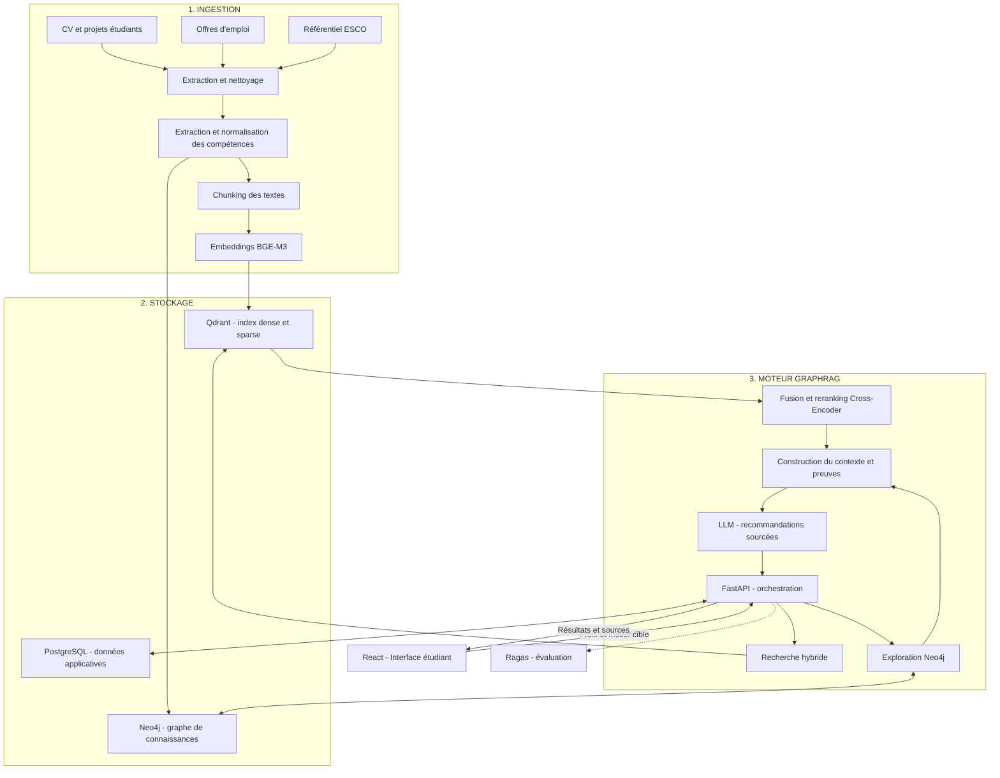

# Architecture technique — PathForge AI

## 1. Présentation générale

PathForge AI est une plateforme intelligente d'analyse des
compétences et d'orientation professionnelle basée sur une
architecture GraphRAG hybride.

Elle permet d'analyser les compétences documentées par les
CV, projets et stages des étudiants, puis de les comparer
aux exigences des métiers.

La solution combine :
- Recherche hybride : BM25 + embeddings.
- Base vectorielle : Qdrant.
- Reranking : Cross-Encoder.
- Graphe de connaissances : Neo4j.
- Génération augmentée : LLM.
- Backend : FastAPI.
- Frontend : React.

L'architecture comporte deux pipelines :
1. Ingestion et préparation des données.
2. Recherche, analyse des écarts et génération.

## 2. Schéma d'architecture générale

## 3. Sources de données

### 3.1 Référentiel ESCO

Source officielle :
https://esco.ec.europa.eu/en/use-esco/download

Version utilisée : ESCO v1.2.1.

Fichiers :
- occupations_en.csv : 3 043 métiers.
- skills_en.csv : 13 960 compétences.
- occupationSkillRelations_data_ai_en.csv :
  674 relations filtrées pour les métiers Data/IA.

Ces données permettront de normaliser les compétences
et de construire les relations métiers-compétences.

Le script scripts/validate_esco.py a validé les 674 relations :
aucun métier ni aucune compétence inconnue n'a été détecté.

### 3.2 Offres d'emploi

Source envisagée :
LinkedIn Job Postings (2023-2024), Kaggle.

https://www.kaggle.com/datasets/arshkon/linkedin-job-postings

Les descriptions d'offres permettront d'identifier
les compétences et qualifications recherchées.

Ce corpus est historique et ne représente pas
nécessairement les exigences actuelles du marché.

### 3.3 Profils étudiants

Corpus à constituer à partir de profils fictifs
ou de données anonymisées et autorisées.

Informations prévues :
- Formations.
- Projets universitaires.
- Stages.
- Compétences.
- Métier cible.

## 4. Pipeline d'ingestion et de préparation

### Étape 1 — Extraction

Python et Pandas permettront de lire et préparer
les fichiers CSV et JSON.

Les CV PDF seront traités avec un outil
d'extraction de texte adapté.

### Étape 2 — Nettoyage et normalisation

- Suppression des doublons.
- Traitement des valeurs manquantes.
- Normalisation des intitulés de métiers.
- Rapprochement des compétences avec ESCO.
- Conservation des identifiants et des sources.

### Étape 3 — Chunking

Stratégie envisagée : Recursive Character Chunking.

- Taille cible : 512 tokens.
- Overlap : 64 tokens.

Les métadonnées conservées comprendront :
doc_id, chunk_id, source et identifiants métier
ou profil lorsque disponibles.

Les relations ESCO resteront structurées
et ne seront pas découpées en chunks textuels.

### Étape 4 — Embeddings

Modèle envisagé : BAAI/bge-m3.

Dimension des vecteurs denses : 1024.

Les représentations seront indexées dans Qdrant.

## 5. Recherche hybride et reranking

### 5.1 Recherche lexicale

BM25 permettra de retrouver les documents
contenant les termes importants de la requête.

### 5.2 Recherche sémantique

Les embeddings permettront d'identifier
les documents sémantiquement proches,
même lorsque les formulations diffèrent.

### 5.3 Fusion des résultats

Les résultats de la recherche lexicale et dense
seront fusionnés afin de produire un classement initial.

### 5.4 Reranking

Un Cross-Encoder, tel que
BAAI/bge-reranker-v2-m3, permettra
de réordonner les passages pertinents.

Objectif :
- Récupération initiale : Top-20.
- Sélection finale : Top-5.

## 6. Graphe de connaissances Neo4j

Neo4j représentera les relations entre les
étudiants, projets, compétences, offres et métiers.

### Entités principales

- Etudiant
- Projet
- Competence
- Metier
- OffreEmploi

### Relations

- Etudiant -> REALISE -> Projet
- Projet -> DOCUMENTE -> Competence
- Metier -> REQUIERT -> Competence
- OffreEmploi -> MENTIONNE -> Competence
- Etudiant -> CIBLE -> Metier

Les relations seront associées à leurs sources
lorsque cela est applicable.

Le graphe permettra de reconstruire les liens
entre les compétences documentées par les étudiants
et celles requises par les métiers.

## 7. Génération des recommandations

Un LLM exploitera :
- Les passages retrouvés par Qdrant.
- Les relations pertinentes du graphe Neo4j.
- Les données du profil étudiant.
- Le métier cible.

Il produira :
1. Les compétences documentées.
2. Les compétences exigées.
3. Les écarts identifiés.
4. Les recommandations personnalisées.
5. Les références justifiant les résultats.

Le LLM devra distinguer les compétences déclarées,
les compétences documentées et celles pour lesquelles
les preuves sont insuffisantes.

En l'absence d'informations suffisantes,
il devra indiquer que les données ne permettent
pas de conclure.

## 8. Backend et frontend

### Backend — FastAPI

FastAPI assurera :
- La validation des requêtes avec Pydantic v2.
- L'orchestration des recherches Qdrant.
- L'interrogation du graphe Neo4j.
- La construction du contexte.
- L'appel au LLM.
- La restitution des réponses et citations.

Le streaming SSE est prévu pour permettre
l'affichage progressif des réponses.

### Frontend — React

L'interface permettra à l'étudiant de :
- Importer son CV.
- Consulter son profil de compétences.
- Sélectionner un métier cible.
- Visualiser les écarts de compétences.
- Consulter les recommandations et leurs sources.

### PostgreSQL

PostgreSQL stockera les informations applicatives,
les profils et les historiques autorisés.

## 9. Évaluation et performances

Les objectifs prévisionnels sont :

| Métrique | Objectif |
|---|---|
| Recall@10 | >= 85 % |
| Faithfulness (Ragas) | >= 0,85 |
| Answer Relevance | >= 0,80 |
| Time-to-First-Token | < 800 ms |
| Latence E2E P95 | < 3,5 s |

Des métriques complémentaires permettront
d'évaluer l'extraction et la normalisation
des compétences ainsi que le classement des offres.

Les performances seront mesurées sur
un jeu d'évaluation annoté.

Ces seuils sont des objectifs et non
des résultats expérimentaux déjà obtenus.

## 10. Sécurité et garde-fous

- Utilisation de profils fictifs pour les tests publics.
- Protection des CV et des informations personnelles.
- Aucun secret ni mot de passe dans GitHub.
- Variables d'environnement pour les configurations sensibles.
- Contrôle des accès aux données applicatives.
- Traçabilité des sources utilisées.
- Limitation des réponses non justifiées.
- Isolation des services dans des réseaux Docker internes.

Les documents récupérés seront traités comme
des données non fiables et non comme des instructions
à exécuter par le LLM.

## 11. Déploiement et environnement

### Conteneurisation

Docker Compose permettra de déployer
progressivement les composants nécessaires.

Qdrant v1.15.5 a déjà été démarré localement
et son tableau de bord a été vérifié.

Les autres services seront intégrés
au cours des prochaines séances.

### CI/CD

GitHub Actions permettra d'automatiser :
- Les tests Pytest.
- Le linting avec Ruff.
- Les vérifications du code.
- Les contrôles de qualité avant intégration.

## 12. État d'avancement

- [x] Dépôt GitHub créé.
- [x] Référentiel ESCO téléchargé.
- [x] Relations ESCO filtrées.
- [x] Validation des identifiants ESCO.
- [x] Qdrant démarré avec Docker.
- [ ] Corpus d'offres d'emploi préparé.
- [ ] Profils étudiants de démonstration constitués.
- [ ] Pipeline d'ingestion complet.
- [ ] Recherche hybride et reranking.
- [ ] Graphe Neo4j opérationnel.
- [ ] Backend FastAPI et interface React.
- [ ] Évaluation Ragas et tests de performance.
- [ ] Déploiement complet et CI/CD.
