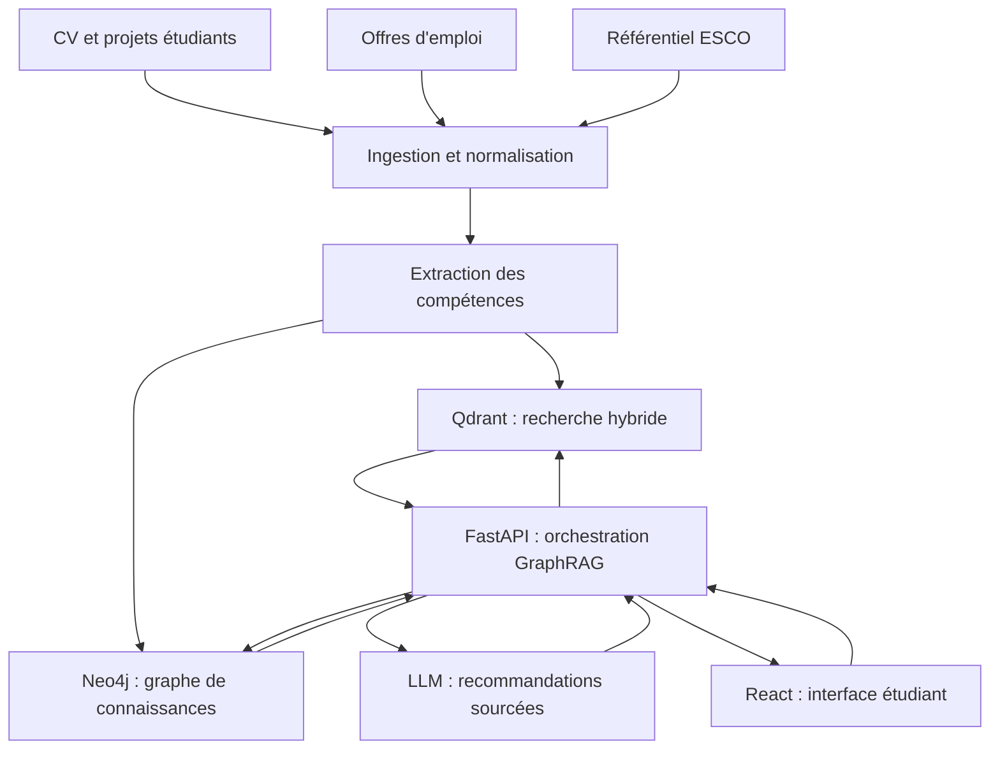

# Architecture technique — PathForge AI

## 1. Architecture générale

PathForge AI repose sur une architecture GraphRAG hybride
associant recherche documentaire, graphe de connaissances
et génération de recommandations sourcées.



## 2. Sources de données

- ESCO : référentiel officiel de métiers et compétences.
- Offres d'emploi : exigences réelles du marché.
- CV et projets étudiants : compétences et expériences documentées.

## 3. Recherche hybride

Qdrant stockera les représentations vectorielles
des documents et permettra de combiner une recherche
dense et une recherche lexicale sparse.

Un Cross-Encoder améliorera le classement
des passages retrouvés.

## 4. Graphe de connaissances

Neo4j représentera les relations :

- Étudiant → réalise → Projet
- Projet → documente → Compétence
- Métier → requiert → Compétence
- Offre → mentionne → Compétence

## 5. Génération des recommandations

Le LLM utilisera les documents retrouvés et les
relations vérifiées du graphe pour expliquer les
correspondances et les écarts de compétences.

## 6. Interface et backend

- FastAPI : API et orchestration.
- React : interface utilisateur.
- PostgreSQL : stockage des profils et historiques.

## 7. Sécurité

- Protection et anonymisation des données personnelles.
- Citations des sources utilisées.
- Distinction entre compétences déclarées et démontrées.
```
